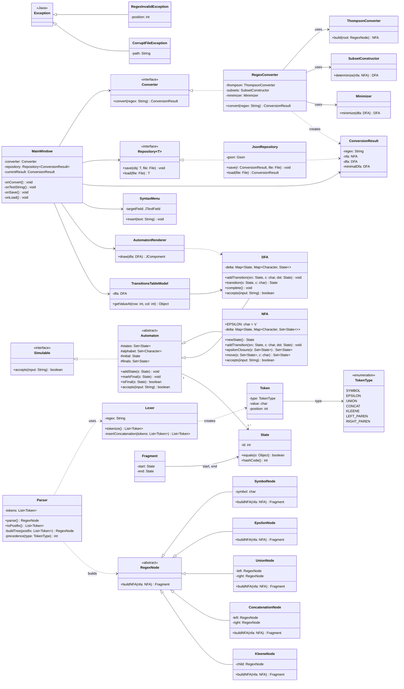
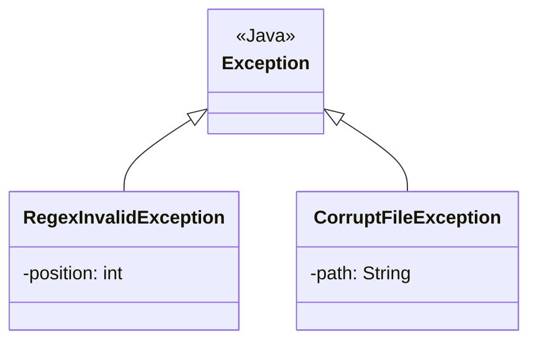
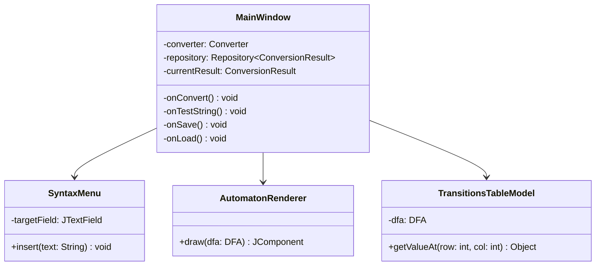
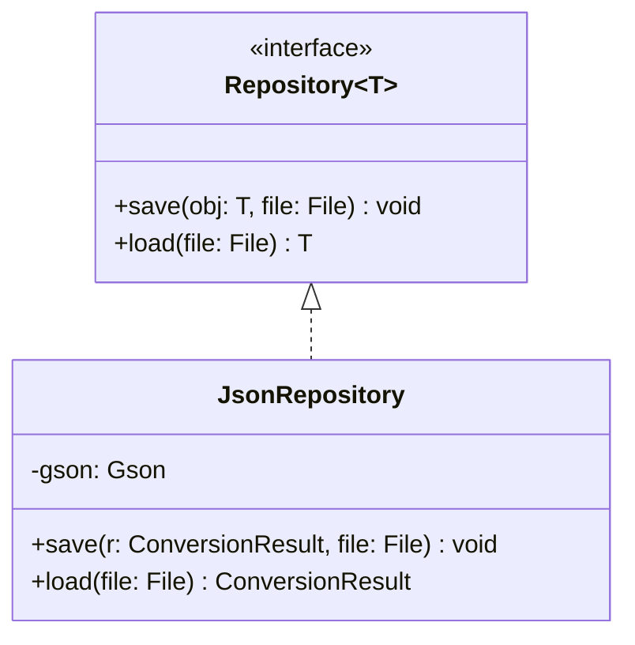
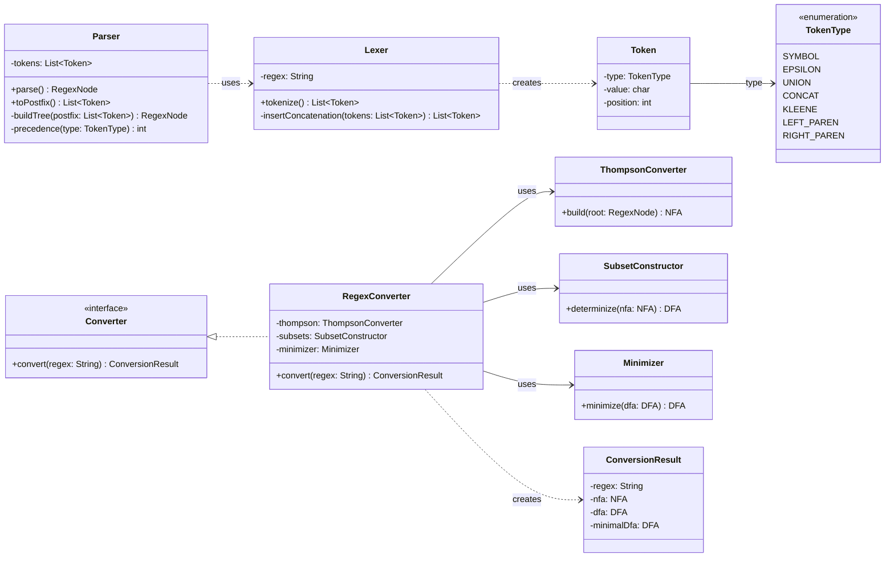
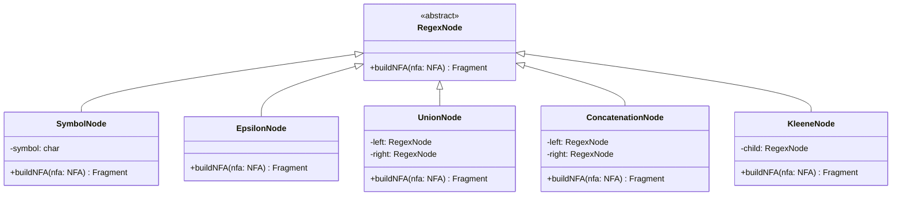
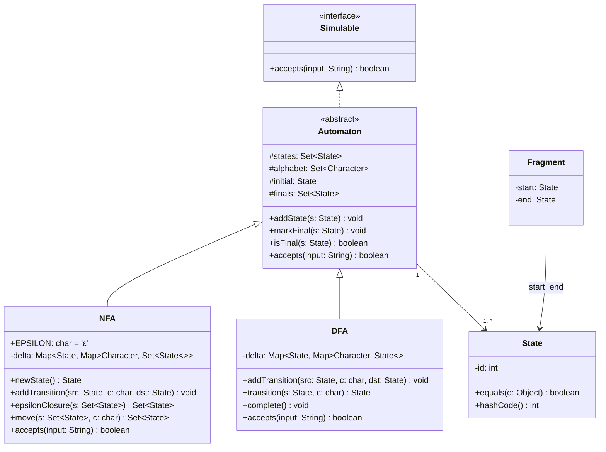

# Class Diagram (simplified version)

UML diagram of the **RegEx → DFA Visualizer** system, organized by package:

- `exceptions`
- `ui`
- `persistence`
- `logic`
- `model`

---

## Overview

---

## Package `exceptions`

| Class | Role |
|---|---|
| `RegexInvalidException` | Syntax error in the regular expression; carries the failing `position`. |
| `CorruptFileException` | Error reading a persisted file; carries the `path`. |

---

## Package `ui`

| Class | Role |
|---|---|
| `MainWindow` | Root UI controller; orchestrates conversion, string testing and persistence. |
| `SyntaxMenu` | Inserts regex alphabet symbols into the input field. |
| `AutomatonRenderer` | Draws the DFA as a Swing component. |
| `TransitionsTableModel` | `TableModel` for the DFA's transitions table. |

---

## Package `persistence`

| Class | Role |
|---|---|
| `Repository<T>` | Generic save/load-by-file contract. |
| `JsonRepository` | Gson-based implementation for `ConversionResult`. |

---

## Package `logic`

**Conversion pipeline**

1. `Lexer` → produces `List<Token>`.
2. `Parser` → builds a `RegexNode` tree (postfix → tree).
3. `ThompsonConverter` → tree to `NFA`.
4. `SubsetConstructor` → `NFA` to `DFA`.
5. `Minimizer` → minimal `DFA`.
6. `RegexConverter` packages everything into `ConversionResult`.

---

## Package `model`

### Regex syntax tree

### Automata

| Class | Role |
|---|---|
| `Simulable` | Contract for accepting/rejecting input strings. |
| `Automaton` | Common base: states, alphabet, initial and final states. |
| `NFA` | Nondeterministic automaton with ε-transitions. |
| `DFA` | Deterministic automaton; `transition` is a total function after `complete()`. |
| `State` | Identity by `id`. |
| `Fragment` | `(start, end)` pair used by Thompson's construction when building the NFA. |

---

## Key cross-package relations

| Source | Target | Type |
|---|---|---|
| `ui.MainWindow` | `logic.Converter` | association |
| `ui.MainWindow` | `persistence.Repository<ConversionResult>` | association |
| `ui.MainWindow` | `logic.ConversionResult` | association |
| `ui.AutomatonRenderer` | `model.DFA` | dependency |
| `ui.TransitionsTableModel` | `model.DFA` | association |
| `persistence.JsonRepository` | `logic.ConversionResult` | dependency |
| `logic.RegexConverter` | `model.RegexNode`, `NFA`, `DFA` | dependency |
