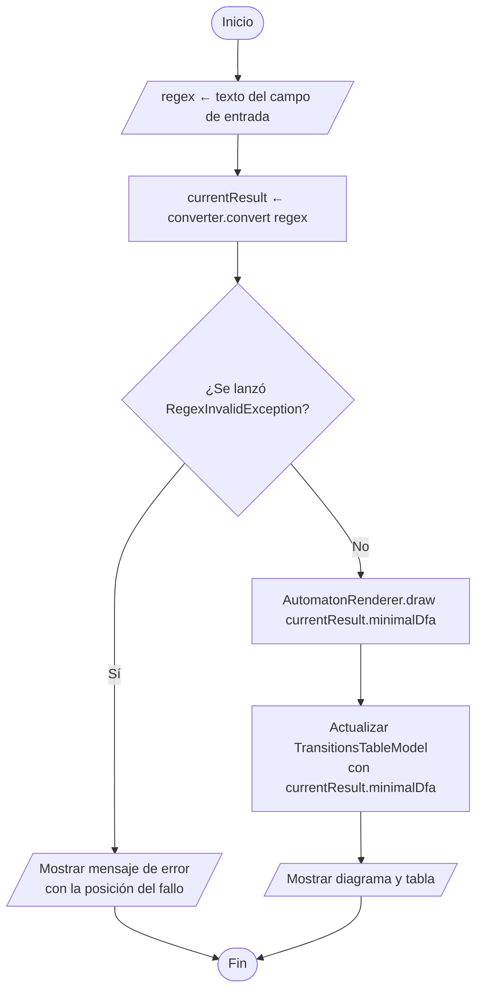
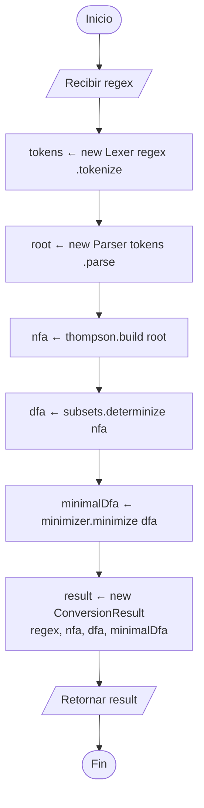

# 0. Pipeline general

Flujo desde que el usuario presiona "Convertir" hasta que se muestra el DFA mínimo.
Clases según [UML.md](../UML.md).

## 0.1 `MainWindow.onConvert()`

## 0.2 `RegexConverter.convert(regex)`

> `Lexer` y `Parser` lanzan `RegexInvalidException`; `convert` no la atrapa, la propaga a `MainWindow`.
