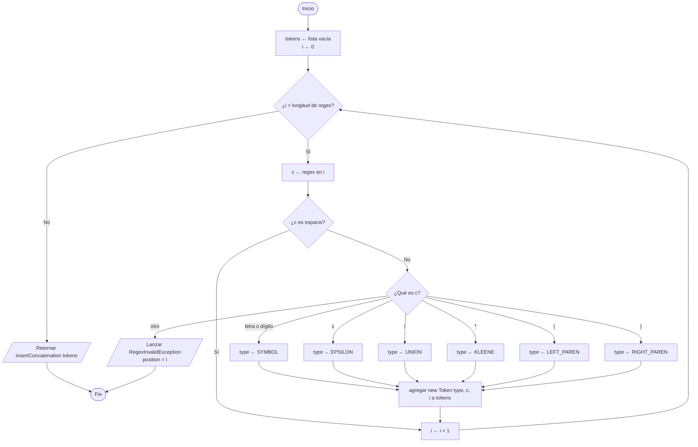
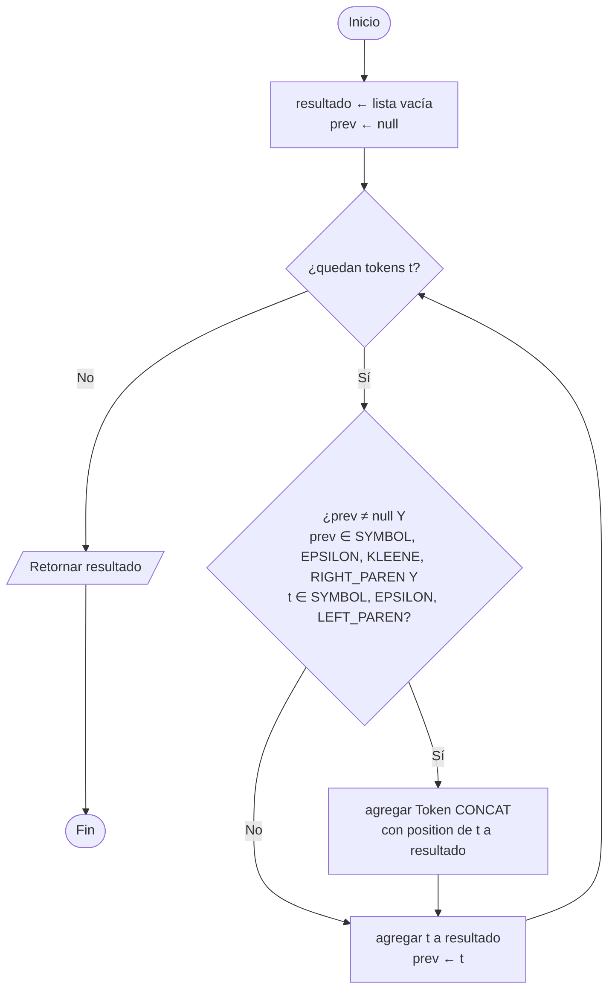

# 1. `Lexer`

Sintaxis (RF02): letras y dígitos, `|`, `*`, `(`, `)`, `ε` y concatenación implícita.

| Carácter | `TokenType` |
|---|---|
| letra o dígito | `SYMBOL` |
| `ε` | `EPSILON` |
| `\|` | `UNION` |
| `*` | `KLEENE` |
| `(` | `LEFT_PAREN` |
| `)` | `RIGHT_PAREN` |
| (insertado) | `CONCAT` |

## 1.1 `tokenize()`

## 1.2 `insertConcatenation(tokens)`

Agrega `CONCAT` entre dos tokens cuando el anterior **termina** un operando y el siguiente **empieza** uno.

Ejemplo: `(a|b)*abb` → `( a | b ) * · a · b · b`
