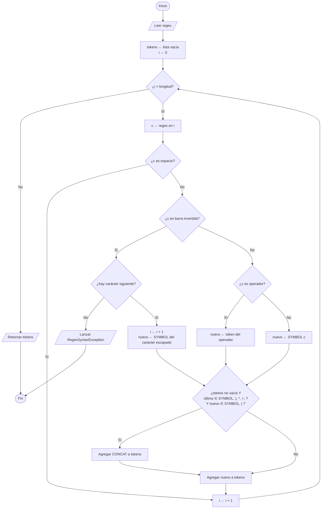

# 1. Lexer (análisis léxico + concatenación implícita)

Convierte la cadena en una lista de tokens e inserta el token `CONCAT` donde la concatenación es implícita
(por ejemplo `ab` → `a · b`, `a(` → `a · (`, `*a` → `* · a`).

Operadores soportados: `|`, `*`, `+`, `?`, `(`, `)`. Cualquier otro carácter es un `SYMBOL` (`\` escapa el siguiente).

