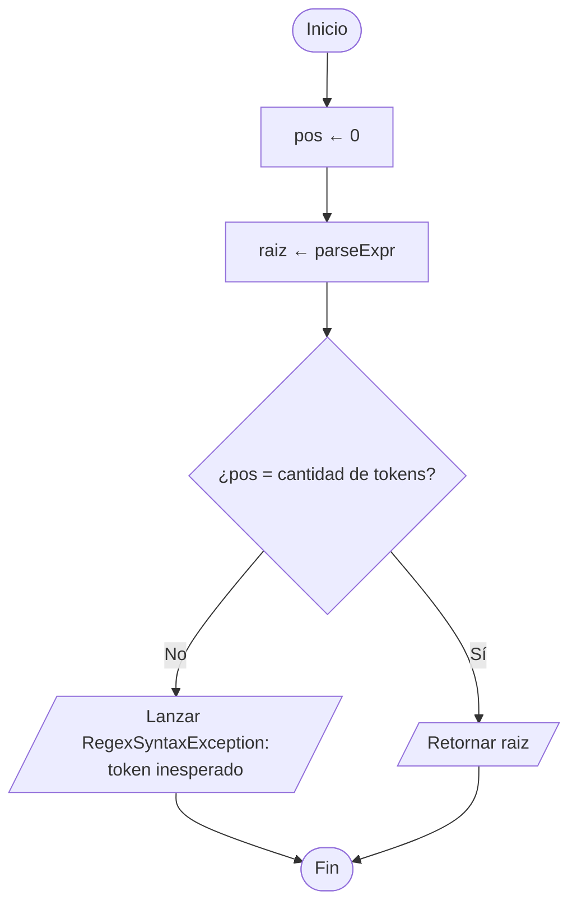
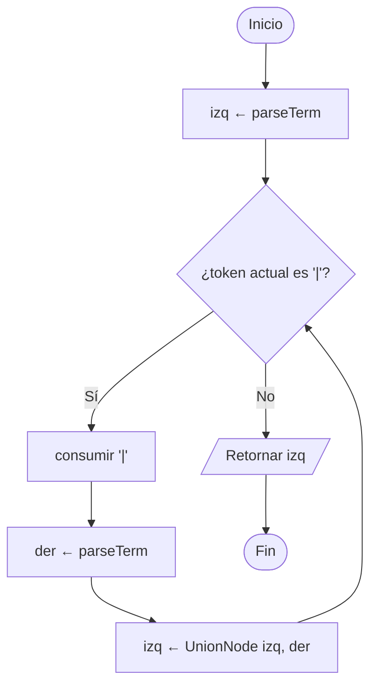
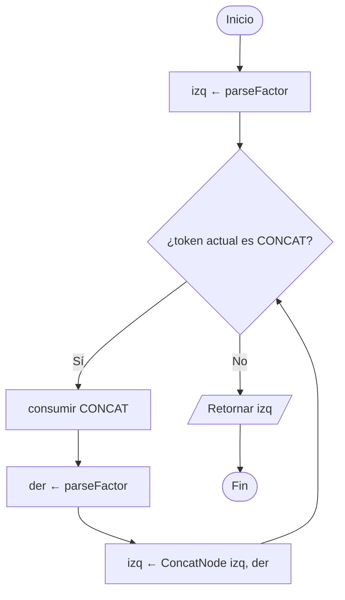
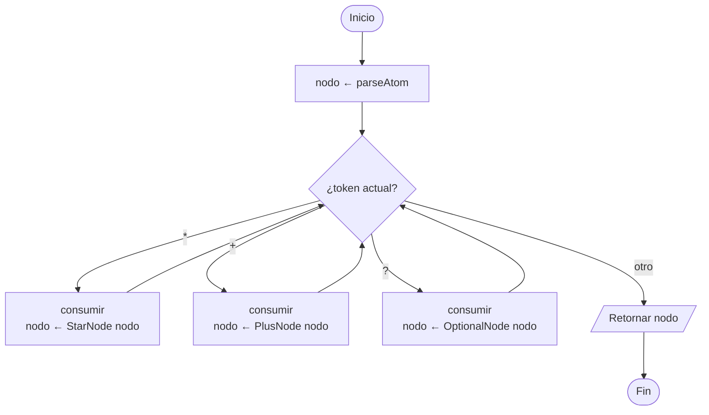
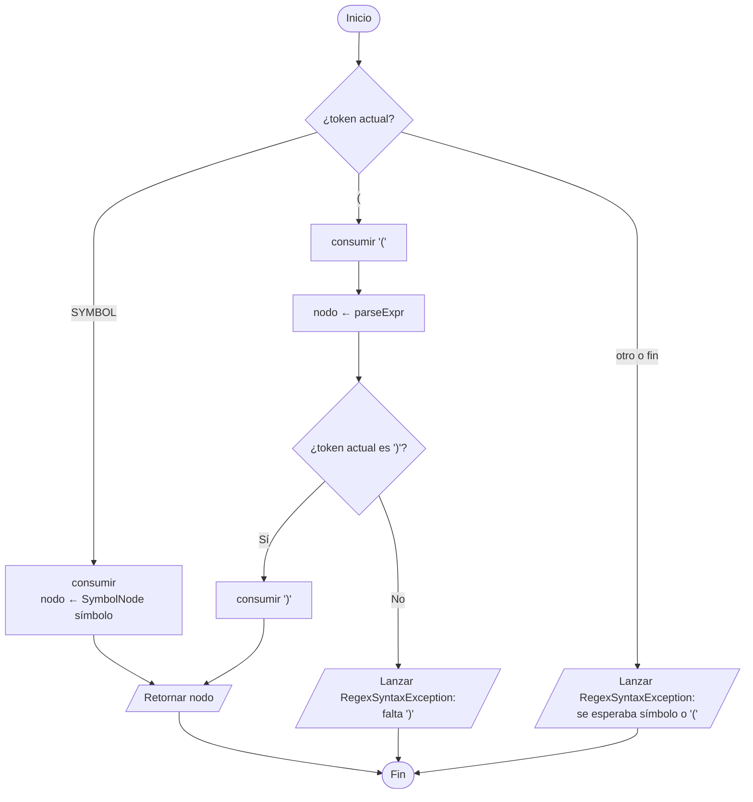

# 2. Parser (descenso recursivo → AST)

Gramática (de menor a mayor precedencia):

```
expr    → term ( '|' term )*
term    → factor ( CONCAT factor )*
factor  → atom ( '*' | '+' | '?' )*
atom    → SYMBOL | '(' expr ')'
```

Cada regla es un método que retorna un `RegexNode` (patrón Composite).

## 2.1 Método `parse()`



## 2.2 `parseExpr()` — unión



## 2.3 `parseTerm()` — concatenación



## 2.4 `parseFactor()` — operadores unarios



## 2.5 `parseAtom()`


