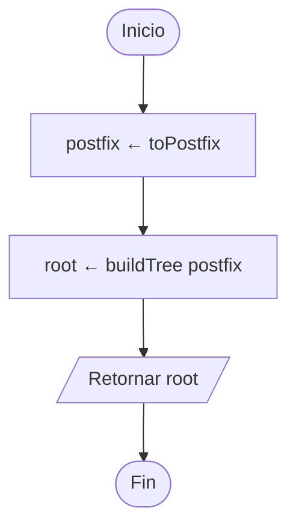
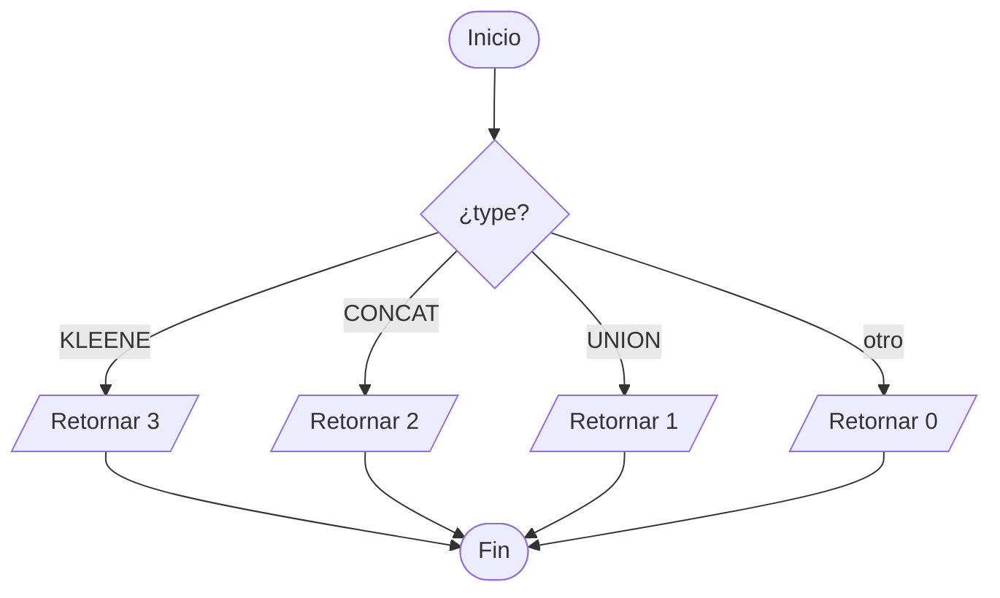
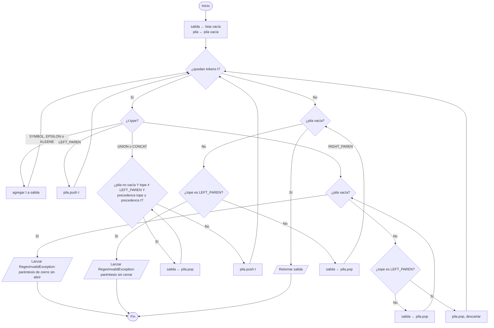
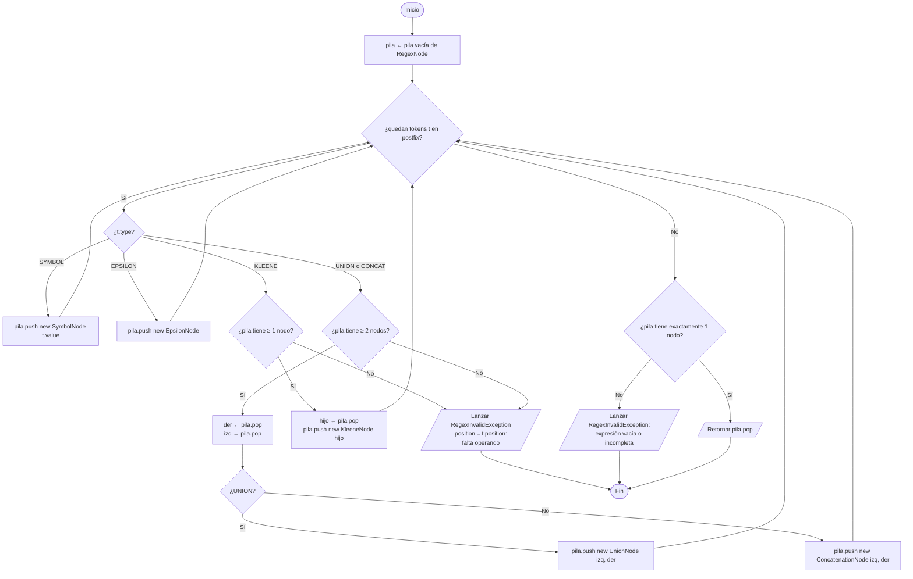

# 2. `Parser` (shunting-yard → árbol)

El parser recibe los tokens del `Lexer`, los pasa a **notación postfija** y con ella construye el árbol de `RegexNode`.

## 2.1 `parse()`

## 2.2 `precedence(type)`

Precedencia (RF02): `*` > concatenación > `|`.

## 2.3 `toPostfix()` — algoritmo shunting-yard

`*` es unario **postfijo**: ya está después de su operando, así que va directo a la salida.

Ejemplo: `( a | b ) * · a · b · b` → `a b | * a · b · b ·`

## 2.4 `buildTree(postfix)`

> Importante: primero se saca `der` y después `izq`, porque la pila invierte el orden.
