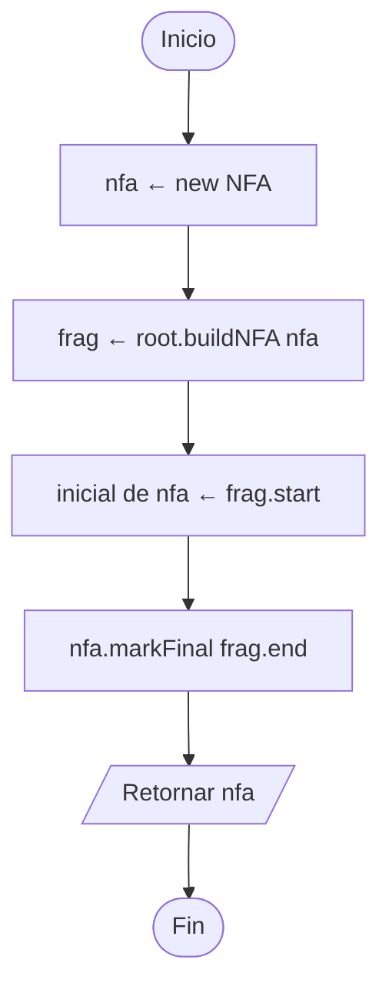
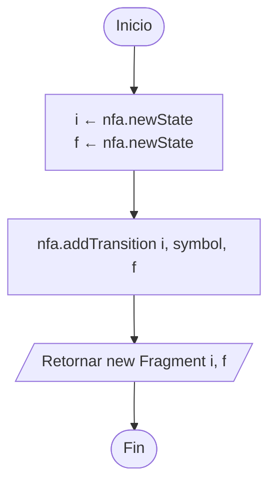
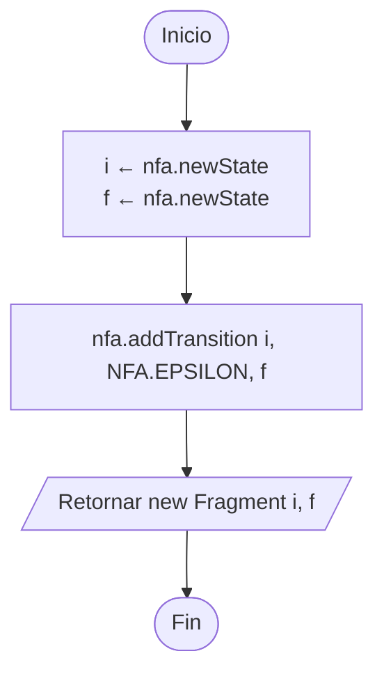
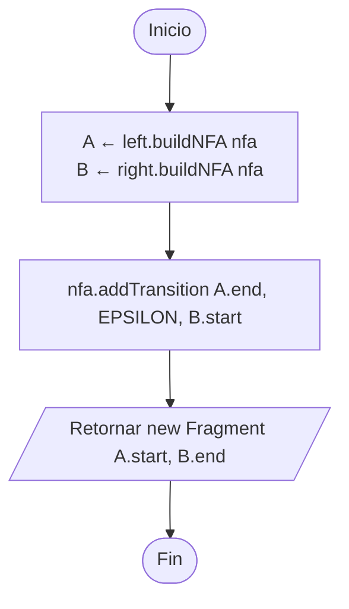
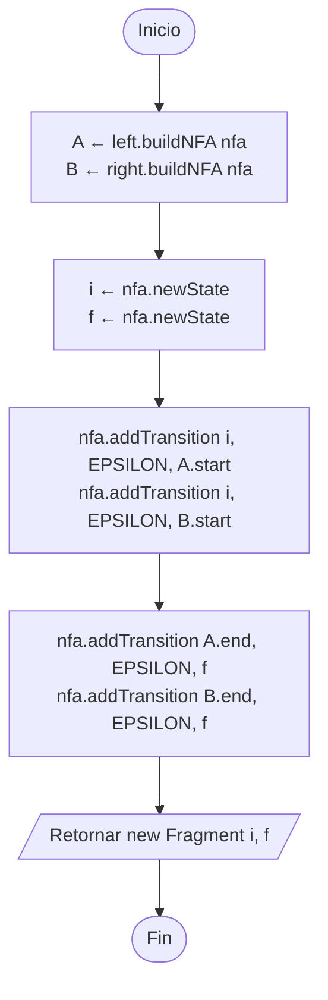
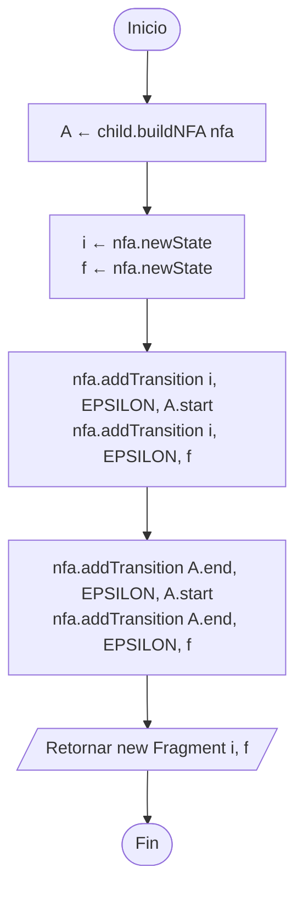

# 3. Construcción de Thompson

`ThompsonConverter.build` le pide a la raíz que se construya. Cada `RegexNode` implementa `buildNFA(nfa)` (**polimorfismo**):
crea sus estados con `nfa.newState()`, agrega sus transiciones y retorna un `Fragment(start, end)`.

## 3.1 `ThompsonConverter.build(root)`

## 3.2 `SymbolNode.buildNFA(nfa)`

## 3.3 `EpsilonNode.buildNFA(nfa)`

## 3.4 `ConcatenationNode.buildNFA(nfa)`

## 3.5 `UnionNode.buildNFA(nfa)`

## 3.6 `KleeneNode.buildNFA(nfa)`

