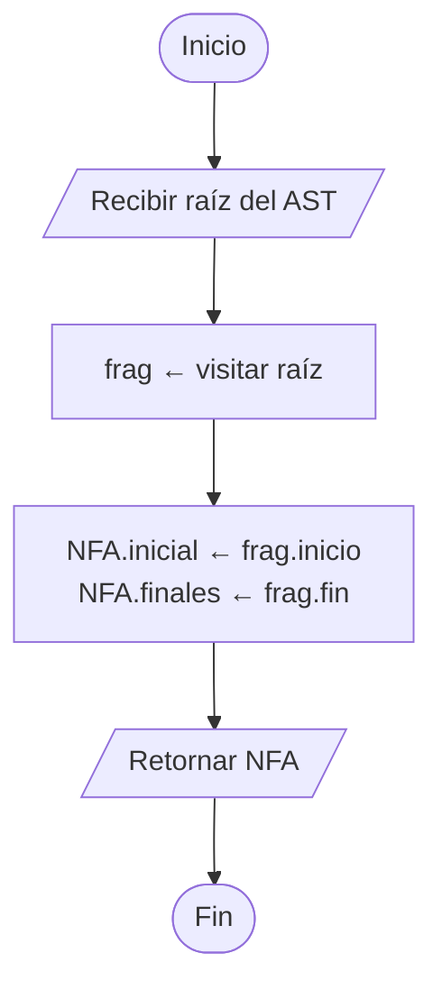
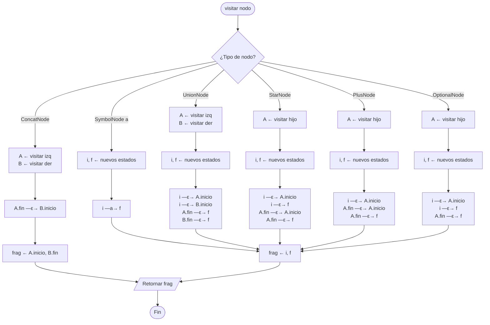

# 3. Construcción de Thompson (AST → NFA-ε)

`ThompsonBuilder` recorre el AST con el patrón **Visitor** (post-orden).
Cada visita retorna un **fragmento** `(inicio, fin)` con un único estado final.

## 3.1 Algoritmo general

## 3.2 `visitar(nodo)` — despacho por tipo de nodo

