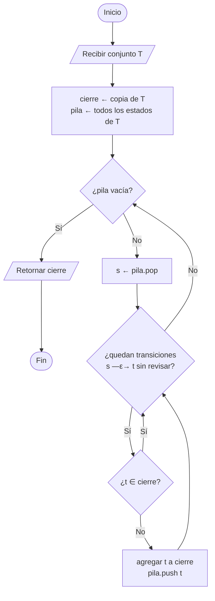
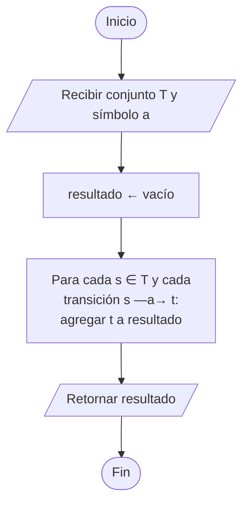
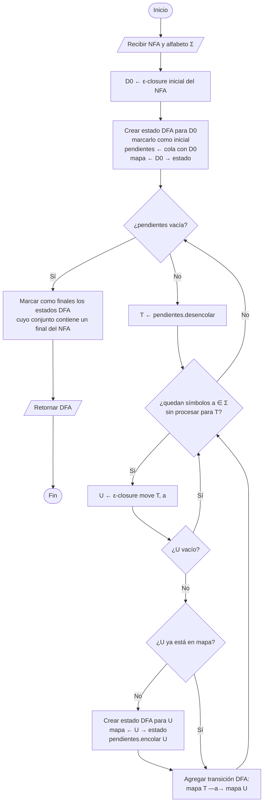

# 4. Construcción de subconjuntos (NFA-ε → DFA)

Cada estado del DFA representa un **conjunto** de estados del NFA.
Usa dos operaciones auxiliares: `ε-closure(T)` y `move(T, a)`.

## 4.1 `ε-closure(T)`

Todos los estados alcanzables desde `T` usando solo transiciones ε.

## 4.2 `move(T, a)`

## 4.3 Algoritmo principal

> Si `U` es vacío no se crea transición (DFA parcial). Si se quiere un DFA completo,
> se agrega un estado sumidero antes de minimizar.
