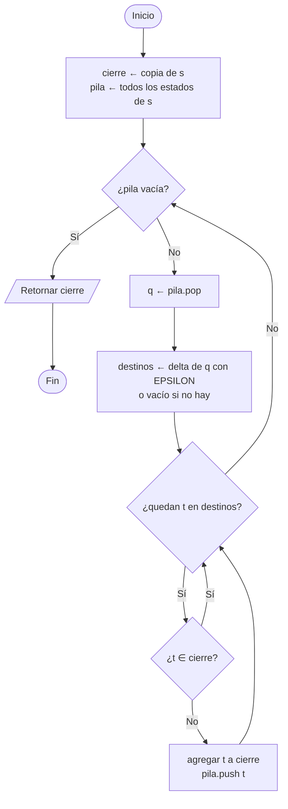
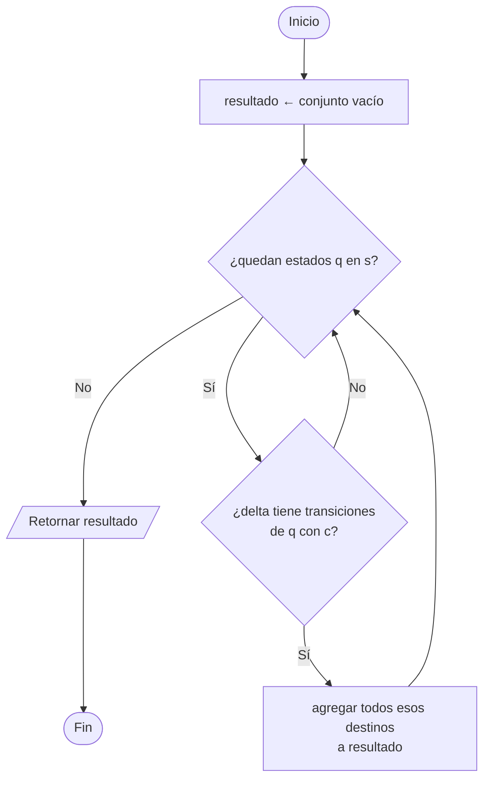
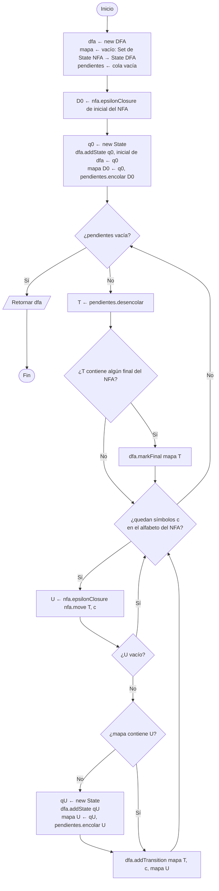

# 4. Construcción de subconjuntos (NFA → DFA)

Cada estado del DFA representa un **conjunto** de estados del NFA.
`SubsetConstructor` usa los métodos `epsilonClosure` y `move` de `NFA`.

## 4.1 `NFA.epsilonClosure(s)`

Todos los estados alcanzables desde `s` usando solo transiciones `EPSILON`.

## 4.2 `NFA.move(s, c)`

## 4.3 `SubsetConstructor.determinize(nfa)`

> Si `U` es vacío no se crea transición. El DFA queda **parcial**; `Minimizer` lo completa con `dfa.complete()`.
