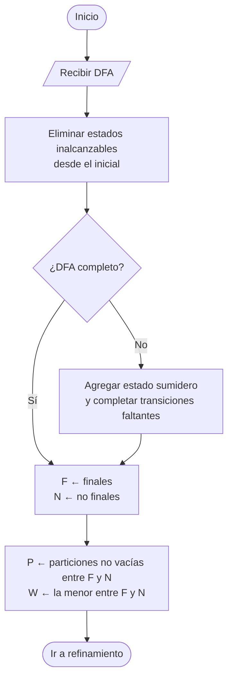
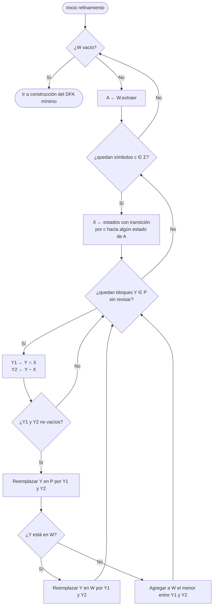
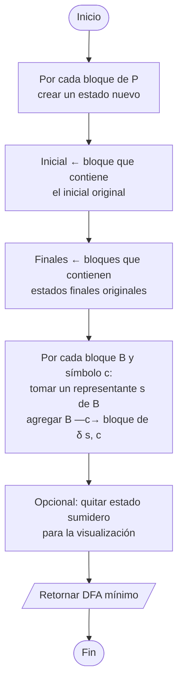

# 5. Minimización de DFA (Hopcroft)

Requisito: DFA **completo** (si falta alguna transición, se agrega un estado sumidero).
Se parte los estados en clases de equivalencia; cada clase final es un estado del DFA mínimo.

## 5.1 Preparación

## 5.2 Refinamiento de particiones

## 5.3 Construcción del DFA mínimo

