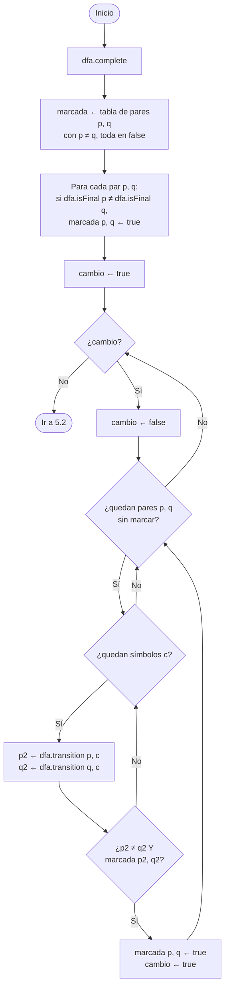
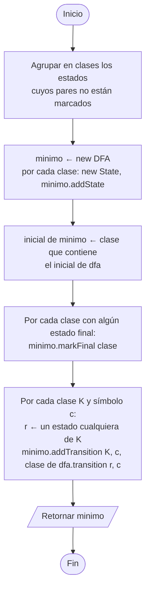

# 5. `Minimizer.minimize(dfa)` — tabla de pares distinguibles

Método de llenado de tabla (REQUIREMENTS: *distinguishable-pairs table*).
Dos estados `p, q` son **distinguibles** si alguna cadena lleva a uno a un estado final y al otro no.

## 5.1 Llenado de la tabla

## 5.2 Construcción del DFA mínimo

Los pares **no marcados** son equivalentes y se fusionan en un solo estado.

> El estado sumidero que agregó `complete()` queda en el DFA mínimo; la vista puede ocultarlo al dibujar.
