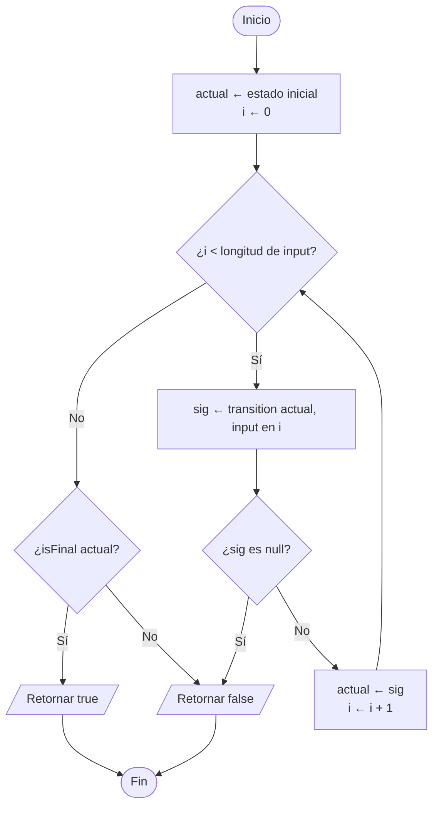
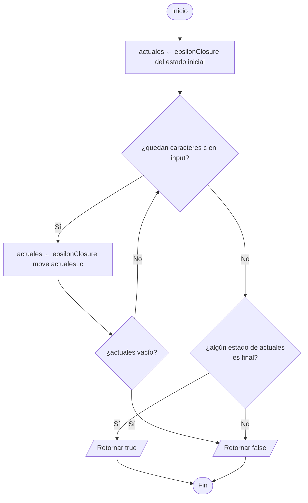

# 6. `accepts(input)` — simular una cadena

`Automaton` implementa `Simulable`; `NFA` y `DFA` sobrescriben `accepts`.
La vista lo usa en `MainWindow.onTestString()` con el DFA mínimo.

## 6.1 `DFA.accepts(input)`

## 6.2 `NFA.accepts(input)`

