# 7. Modelo: autómatas (`model/automata`)

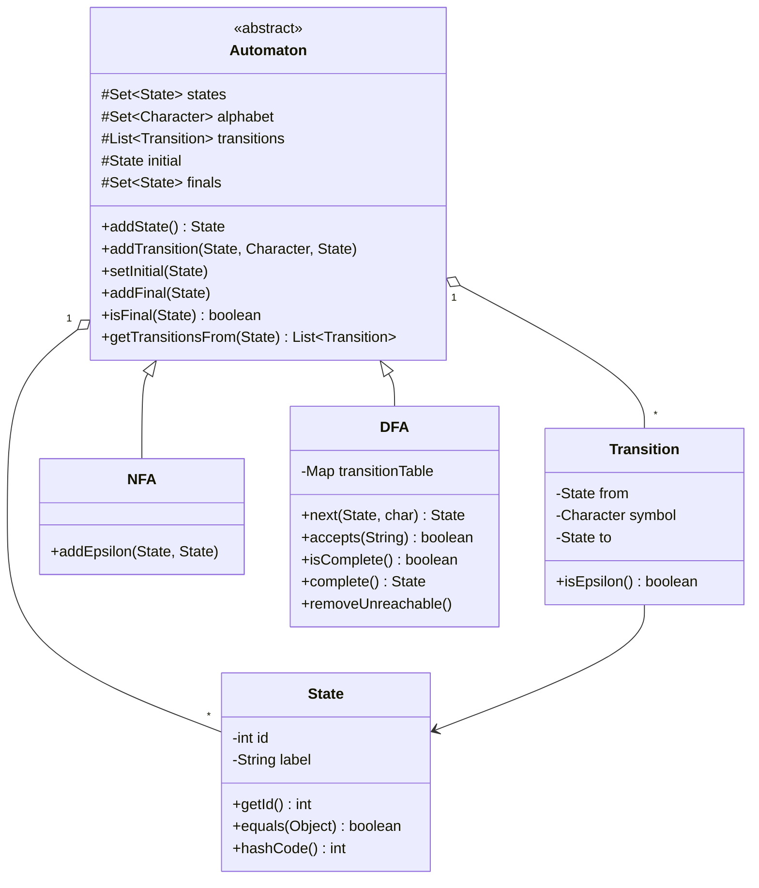

> En el código, ε es `symbol == null` (o la constante `Transition.EPSILON`).

---

## 7.1 `State.equals(Object o)`

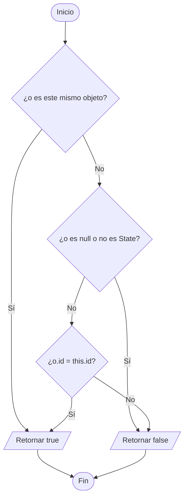

`hashCode()` retorna el hash de `id`, para que los estados funcionen en `Set` y `Map`.

## 7.2 `Transition.isEpsilon()`

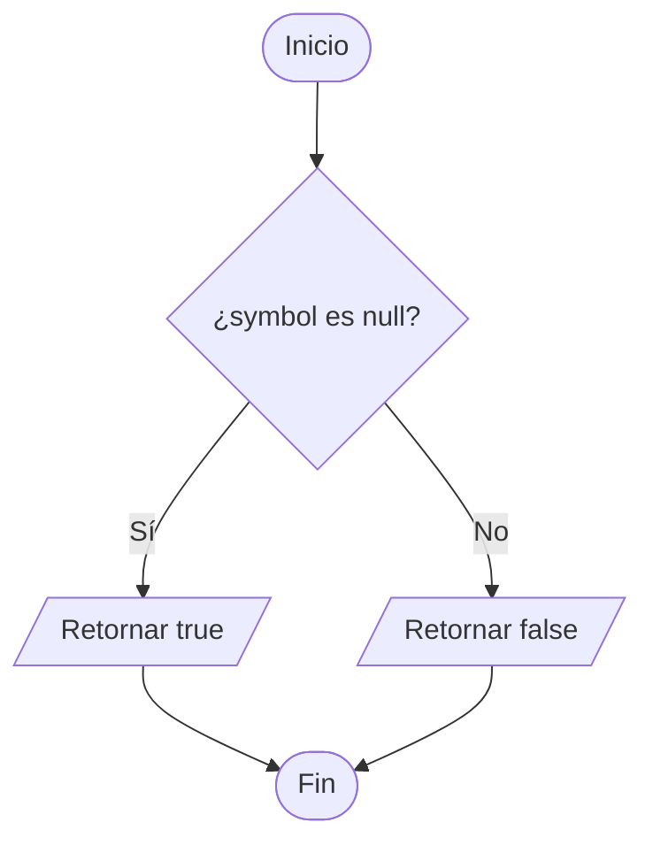

## 7.3 `Automaton.addState()`

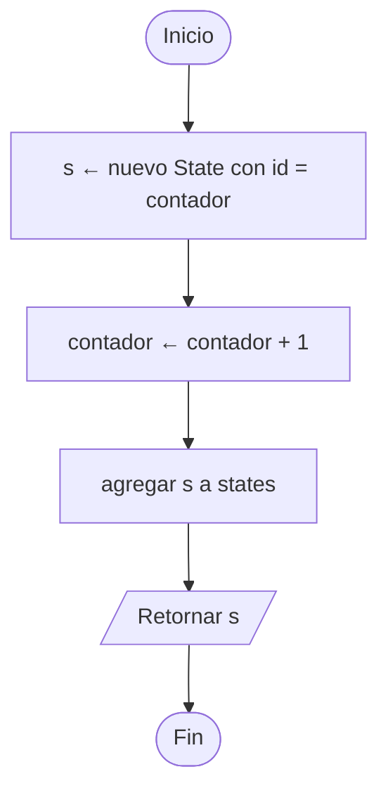

## 7.4 `Automaton.addTransition(from, symbol, to)`

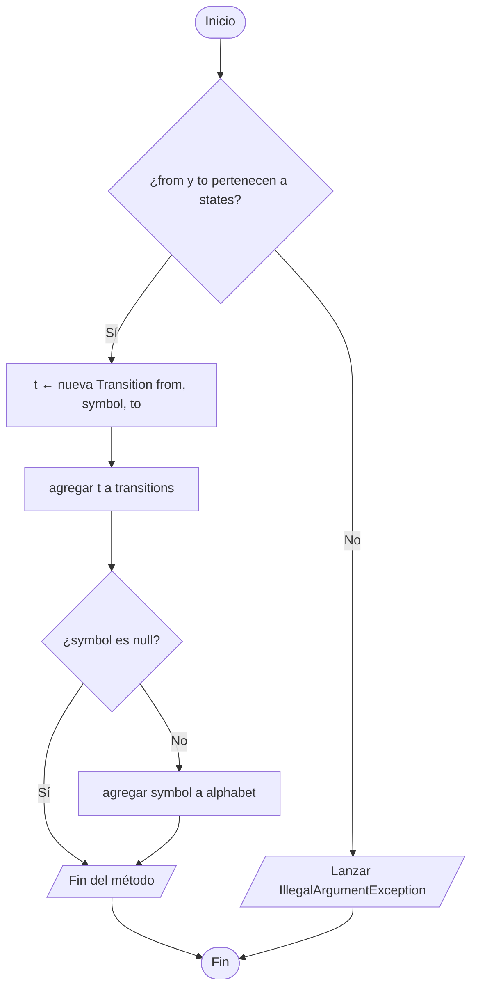

`NFA.addEpsilon(from, to)` solo llama a `addTransition(from, null, to)`.

## 7.5 `Automaton.setInitial(s)` y `addFinal(s)`

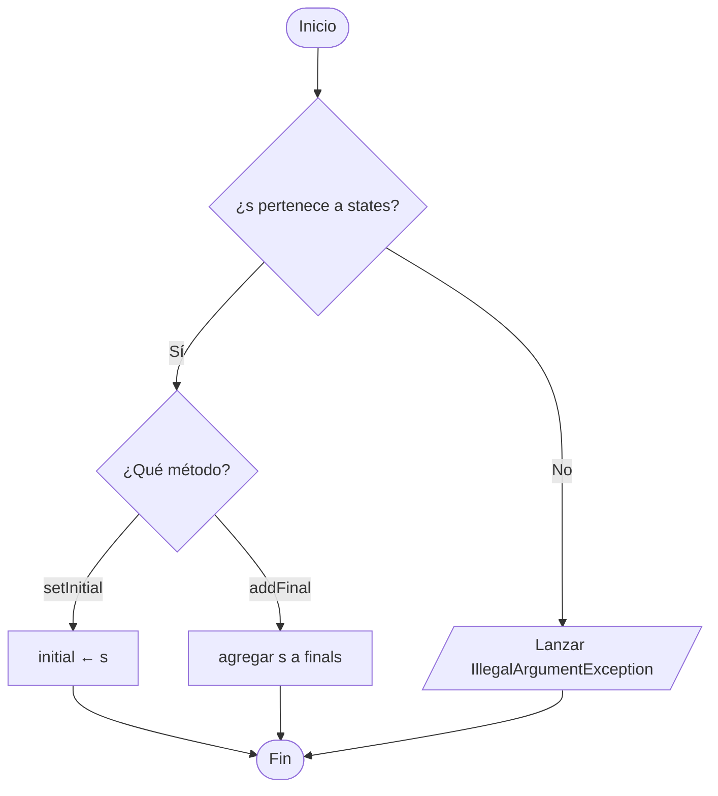

## 7.6 `Automaton.isFinal(s)`

## 7.7 `Automaton.getTransitionsFrom(s)`

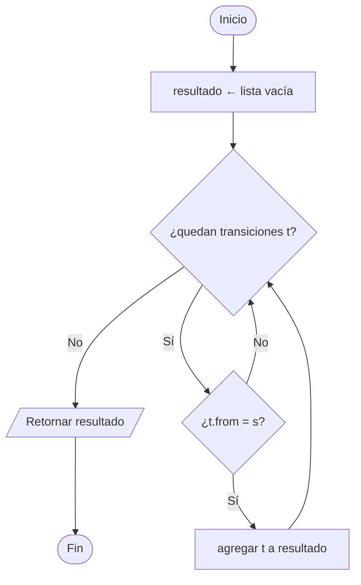

---

## 7.8 `DFA.addTransition(from, symbol, to)` — sobrescrito

En un DFA no puede haber ε ni dos transiciones con el mismo símbolo desde un estado.

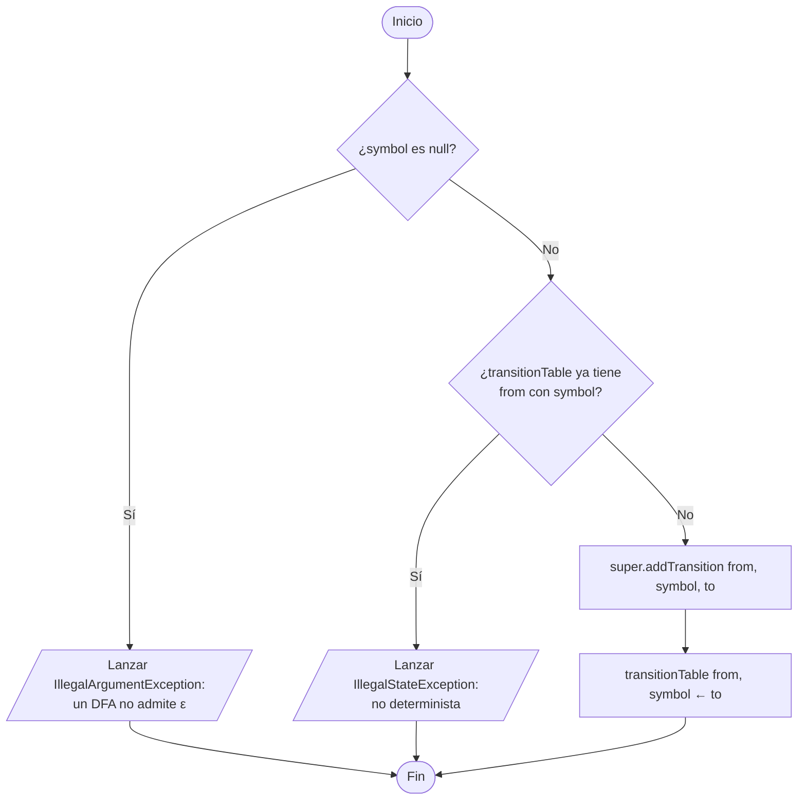

## 7.9 `DFA.next(s, c)`

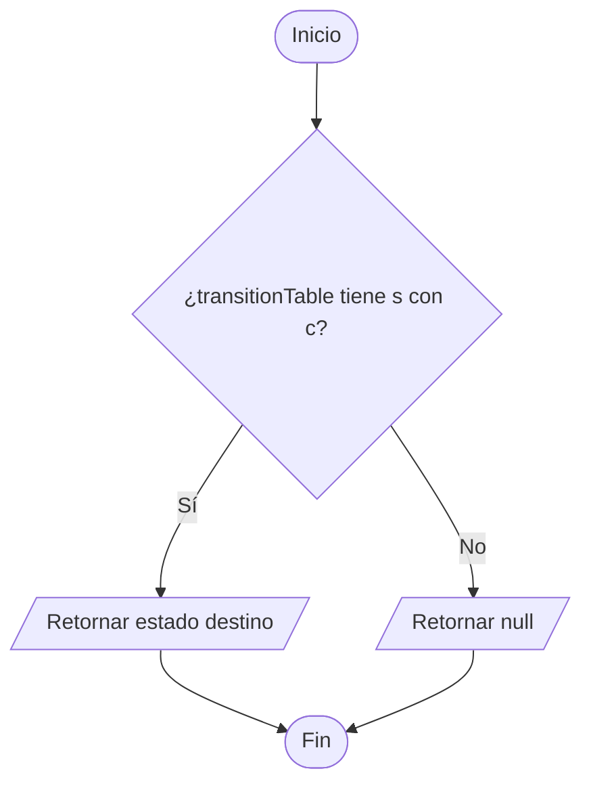

`DFA.accepts(w)` usa `next` en un ciclo; su diagrama está en [06-simulacion-dfa.md](06-simulacion-dfa.md).

## 7.10 `DFA.isComplete()`

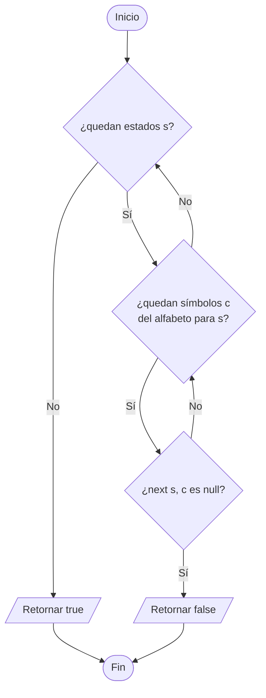

## 7.11 `DFA.complete()` — agrega el estado sumidero

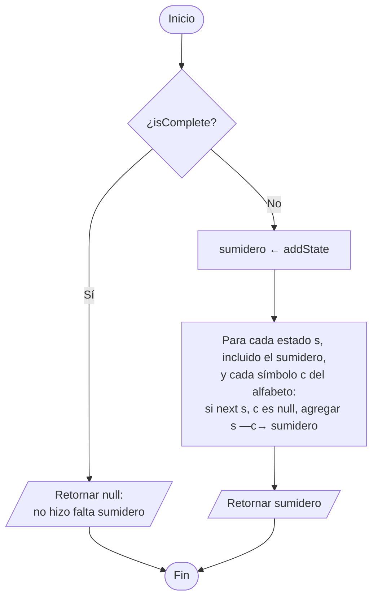

## 7.12 `DFA.removeUnreachable()`

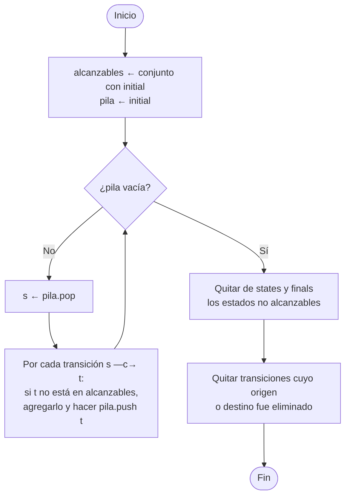
