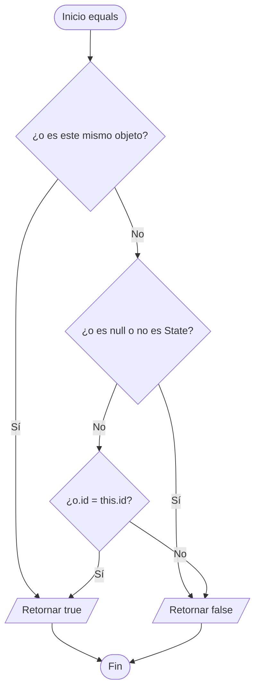
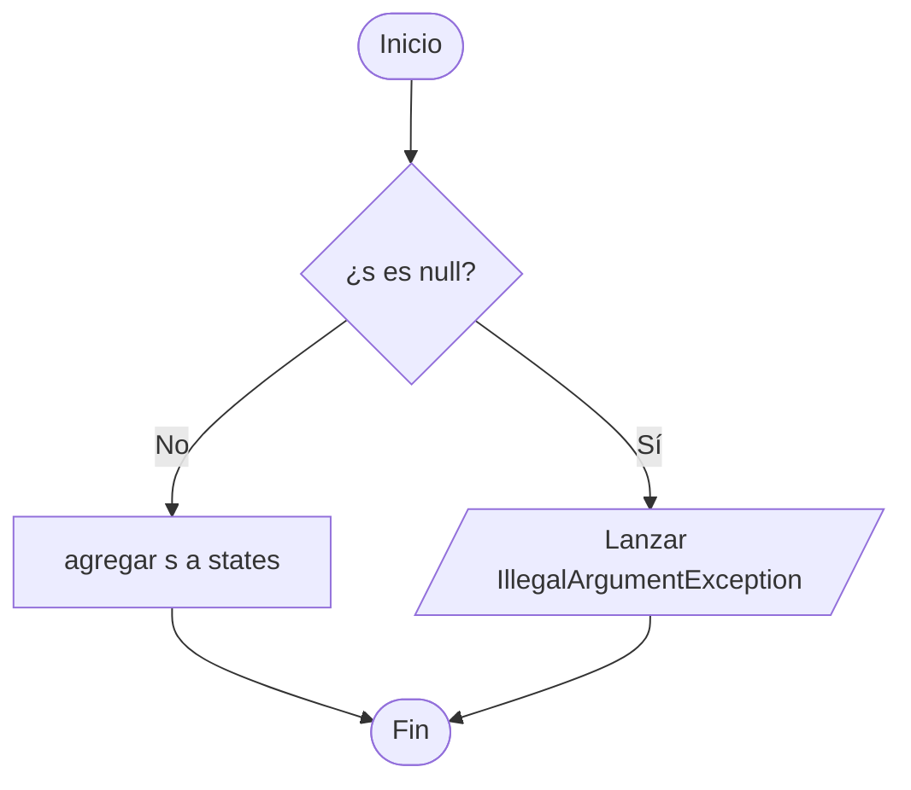
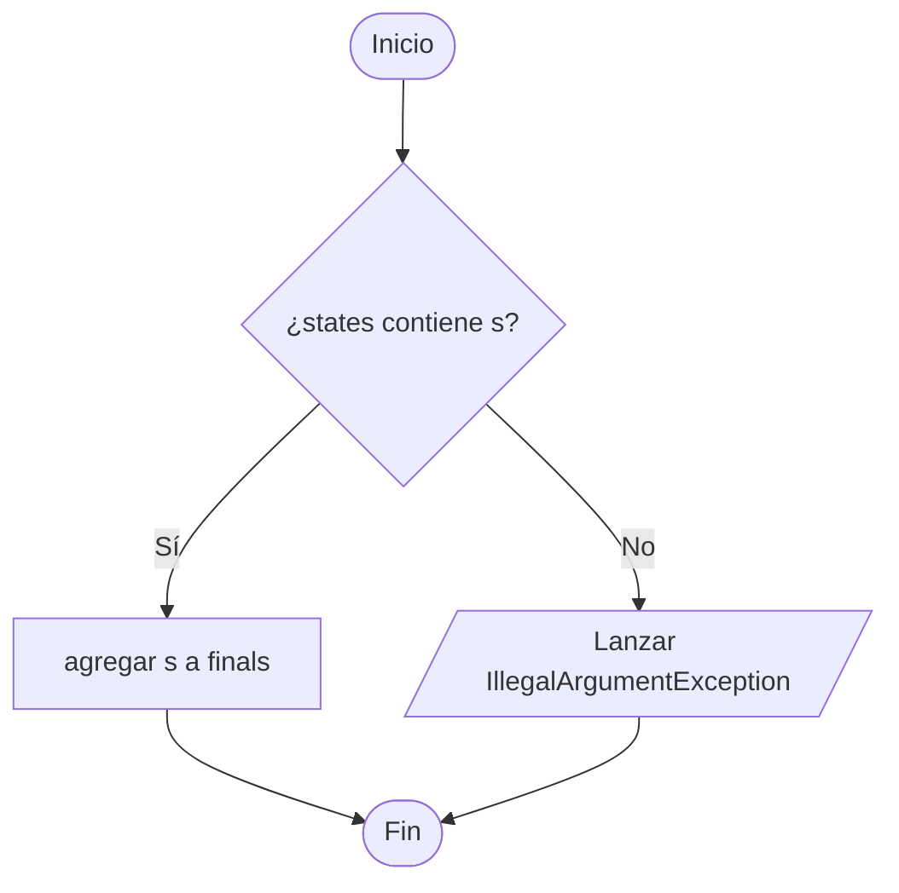
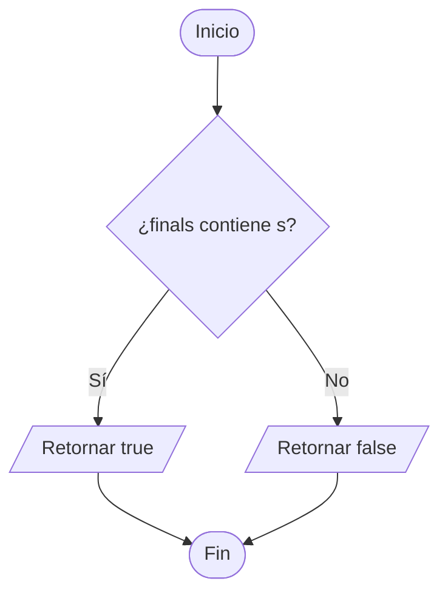
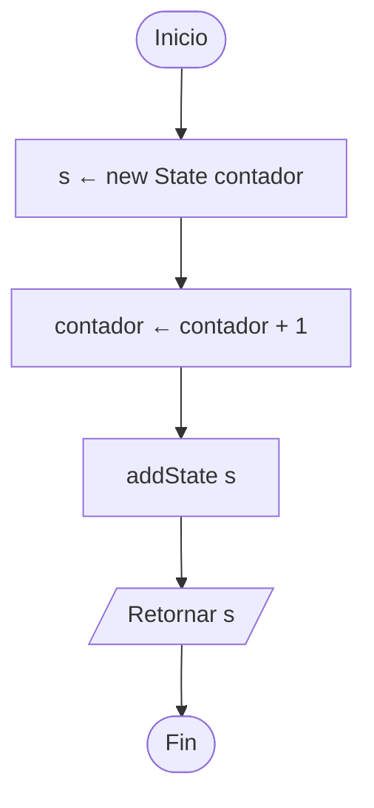
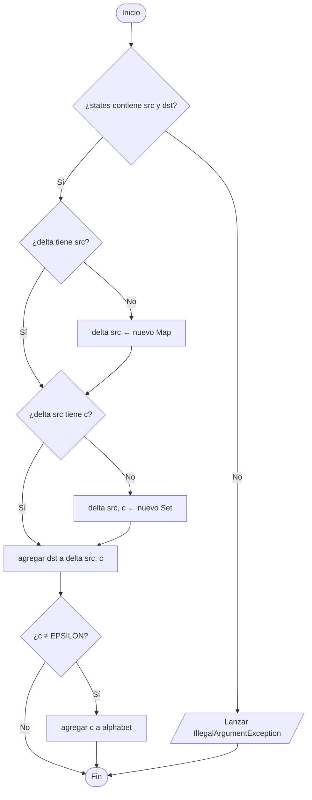
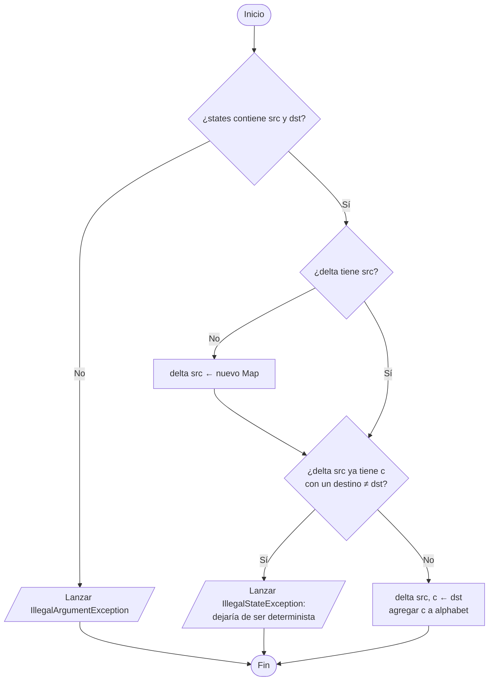
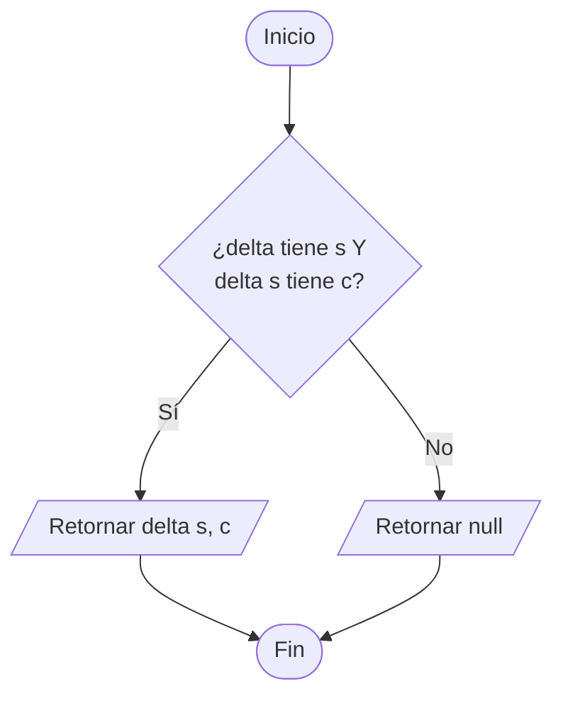
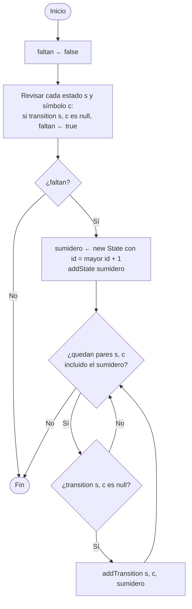

# 7. Métodos del modelo de autómatas

Métodos de `State`, `Automaton`, `NFA` y `DFA` según [UML.md](../UML.md).
Los demás métodos de estas clases están en otros diagramas:

- `NFA.epsilonClosure` y `NFA.move`: [04-subconjuntos.md](04-subconjuntos.md)
- `accepts` de `NFA` y `DFA`: [06-simulacion-dfa.md](06-simulacion-dfa.md)

## 7.1 `State.equals(o)` y `hashCode()`

`hashCode()` retorna `Integer.hashCode(id)`. Es obligatorio sobrescribir los dos para que `State` funcione en `Set` y `Map`.

## 7.2 `Automaton.addState(s)`

## 7.3 `Automaton.markFinal(s)`

## 7.4 `Automaton.isFinal(s)`

---

## 7.5 `NFA.newState()`

## 7.6 `NFA.addTransition(src, c, dst)`

`delta: Map<State, Map<Character, Set<State>>>` — un mismo símbolo puede ir a varios estados.

---

## 7.7 `DFA.addTransition(src, c, dst)`

`delta: Map<State, Map<Character, State>>` — cada símbolo va a **un solo** estado.

## 7.8 `DFA.transition(s, c)`

## 7.9 `DFA.complete()`

Deja `transition` como función total agregando un estado **sumidero**.

