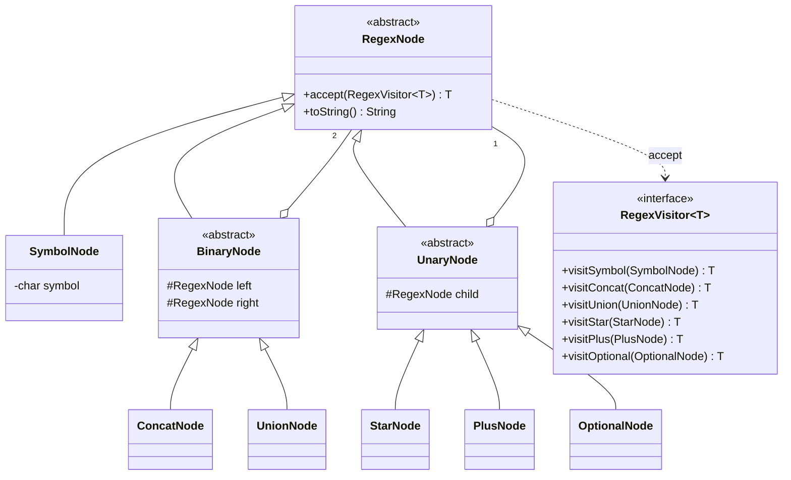
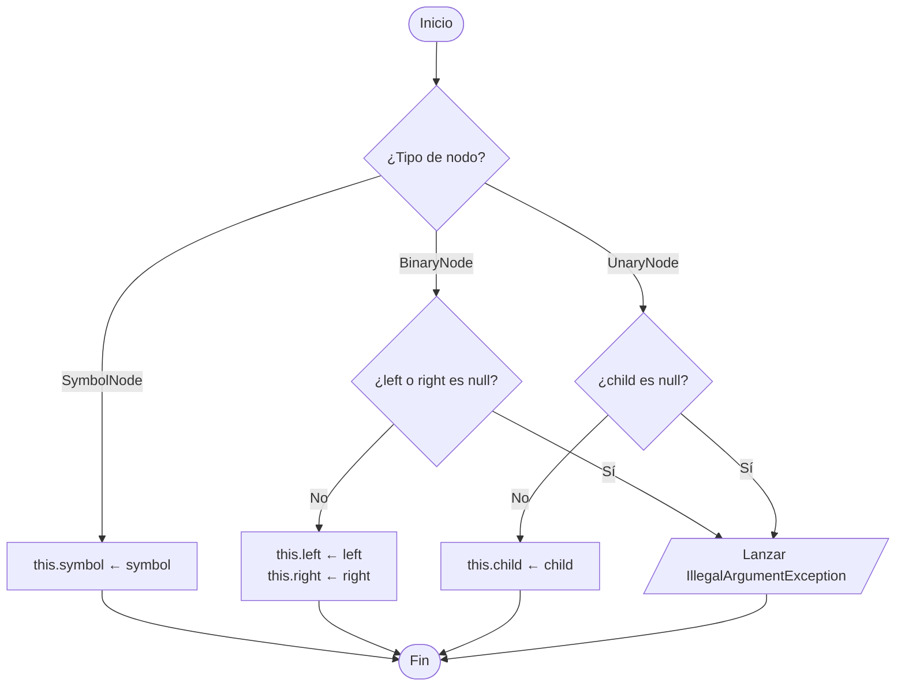
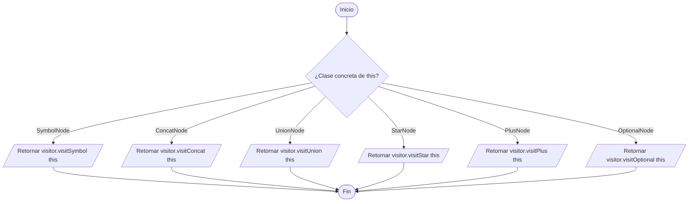
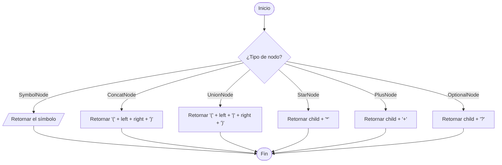

# 8. Modelo: AST de la regex (`model/ast`)

Patrón **Composite** (nodos hoja y compuestos) + **Visitor** (operaciones sobre el árbol).

`ThompsonBuilder` implementa `RegexVisitor<Fragment>`; su diagrama está en [03-thompson.md](03-thompson.md).

---

## 8.1 Constructores

## 8.2 `accept(visitor)` — double dispatch

Cada subclase concreta llama al método del visitor que le corresponde.

> No hay un `if` real: el polimorfismo elige el método. El diagrama solo muestra qué hace cada subclase.

## 8.3 `toString()` — reconstruye la regex con paréntesis

Útil para depurar el parser y mostrar el AST en la vista.

Ejemplo: `(a|b)*abb` → `((((a|b)*a)b)b)`.
