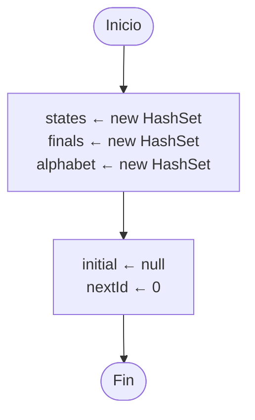
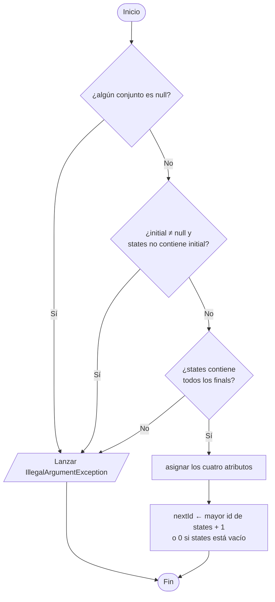
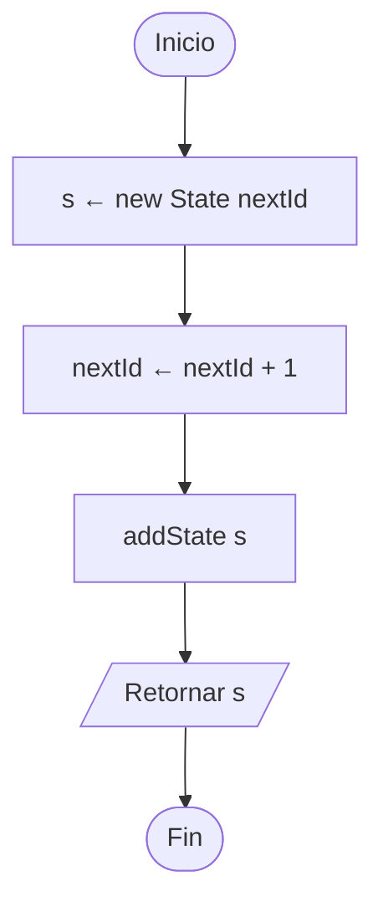
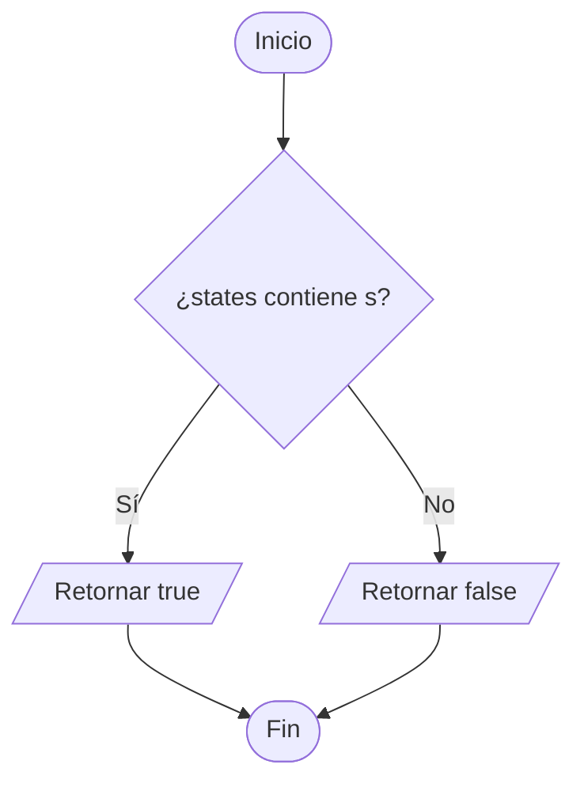
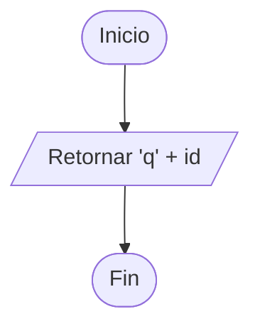
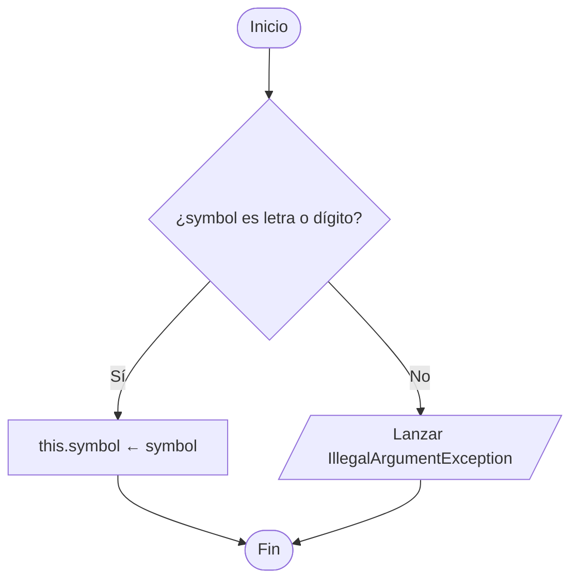
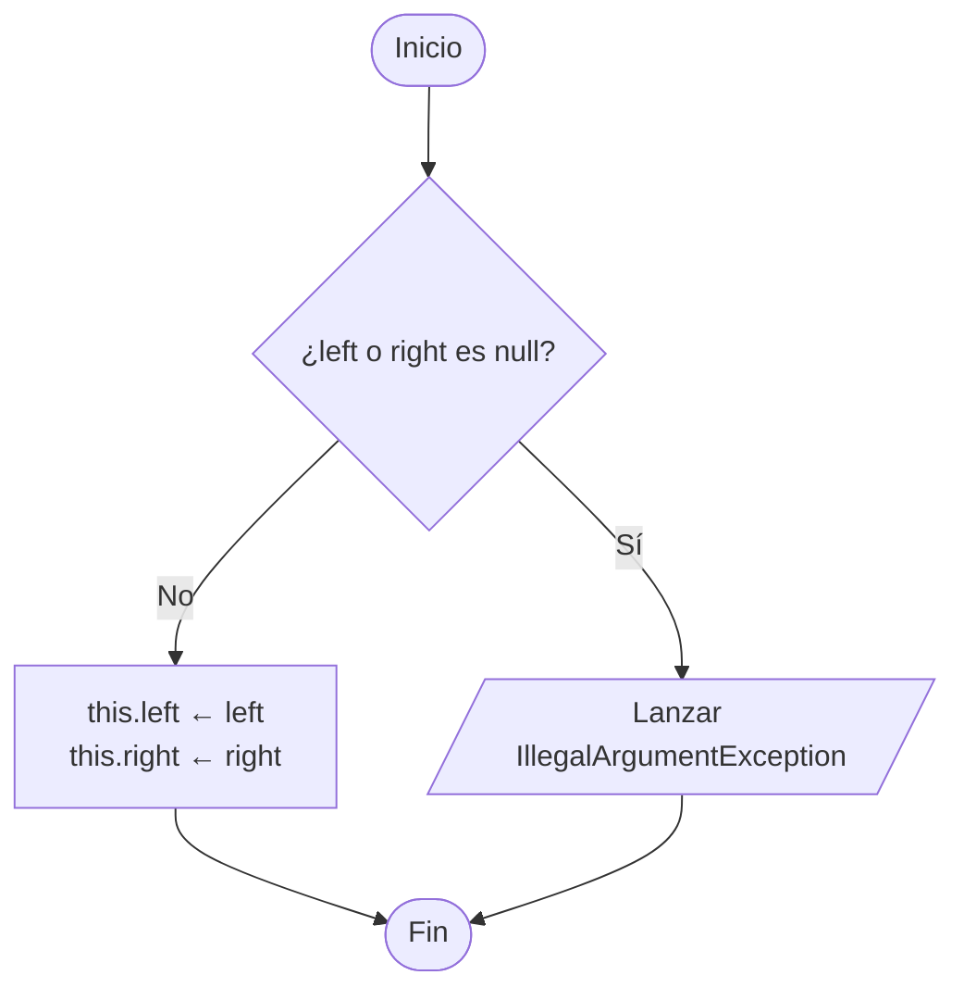
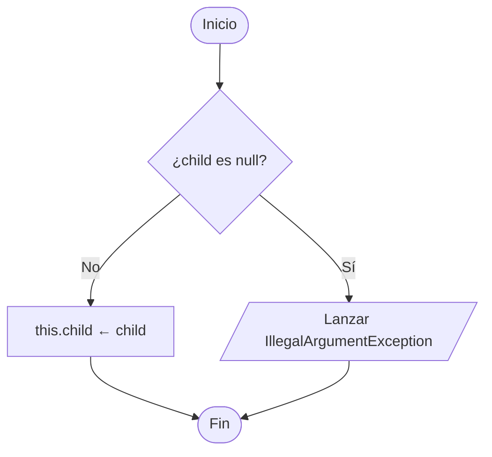
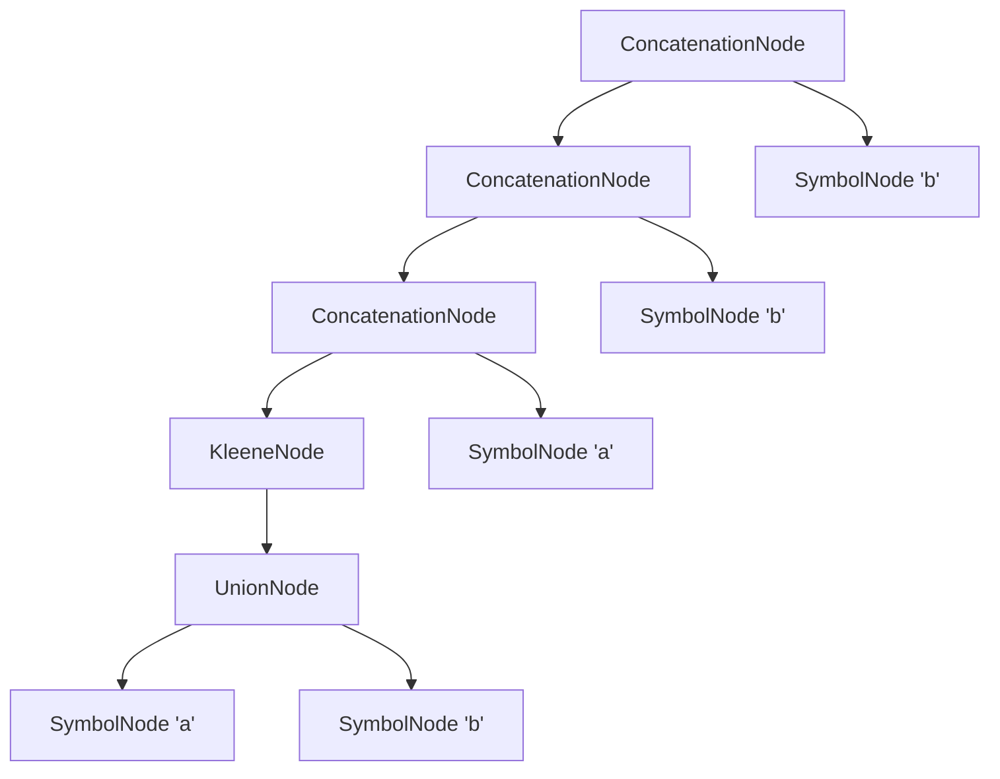

# 8. Métodos del modelo que faltaban

Constructores y métodos auxiliares de `Automaton`, `Fragment`, `State` y los nodos del árbol (`RegexNode`).
Son los que necesita Thompson ([03-thompson.md](03-thompson.md)) para funcionar y que todavía no tenían diagrama.

---

## 8.1 `Automaton()` — constructor vacío

Lo usa `ThompsonConverter.build` para crear un `NFA` desde cero.

## 8.2 `Automaton(initial, finals, alphabet, states)` — constructor con datos

Lo usan `SubsetConstructor` y `Minimizer` cuando ya tienen los conjuntos armados.

## 8.3 `Automaton.newState()`

## 8.4 `Automaton.hasState(s)`

---

## 8.5 `Fragment(start, end)` y getters

`getStart()` y `getEnd()` solo retornan el atributo. No hay setters: un fragmento no cambia después de creado.

## 8.6 `State.toString()`

Lo usan `TransitionsTableModel` y `AutomatonRenderer` para mostrar `q0`, `q1`, …

---

## 8.7 Constructores de los nodos del árbol

`EpsilonNode()` no tiene atributos, así que su constructor está vacío.

### `SymbolNode(symbol)`

### `UnionNode(left, right)` y `ConcatenationNode(left, right)`

### `KleeneNode(child)`

### Ejemplo: árbol de `(a|b)*abb`

Así queda el árbol que `Parser.buildTree` arma con estos constructores (concatenación asociativa por la izquierda):

